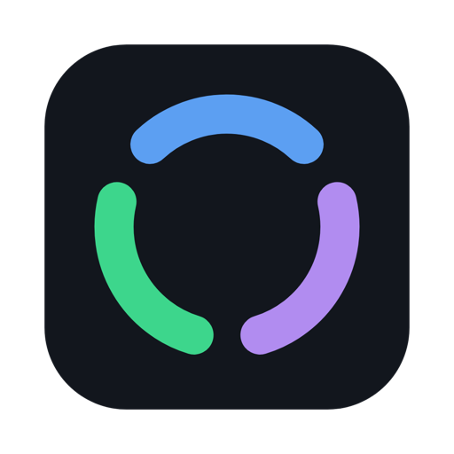
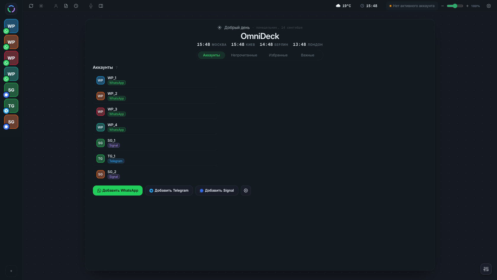
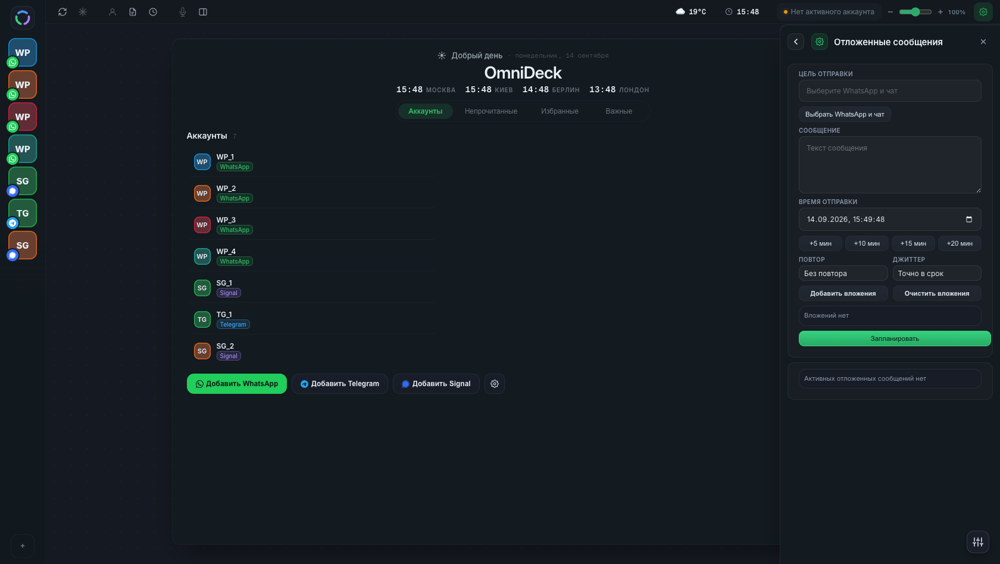

<div align="center">



# OmniDeck

**Один рабочий стол для десятков аккаунтов WhatsApp, Telegram и Signal.**

Десктопное приложение для тех, кто ведёт переписку профессионально: поддержка,
продажи, операторы. Все аккаунты в одном окне, с переводчиком, шаблонами,
отложенной отправкой и заметками по контактам.

[](https://github.com/tamilamokrousova0/OmniDeck/releases/latest)
[](https://github.com/tamilamokrousova0/OmniDeck/releases)




</div>

> **In short.** OmniDeck is a desktop deck for people who run dozens of
> messenger accounts at once. It puts WhatsApp Web, Telegram Web and Signal
> side by side in one window and adds the things an operator actually needs:
> inline translation, message templates, scheduled sending, per-contact notes
> and a single unread feed. macOS (Apple Silicon) and Windows. UI is Russian.

---

## Зачем это

Десять вкладок браузера с WhatsApp — это десять разных окон, десять счётчиков
и постоянная потеря контекста. OmniDeck собирает их в одну деку: слева список
аккаунтов, справа рабочая область, сверху общие инструменты.

- **Не теряется входящее.** Общая лента непрочитанных по всем аккаунтам,
  уведомления и счётчик на иконке в доке.
- **Меньше кликов.** Шаблоны по слэшу прямо в поле ввода, быстрый переход по
  контакту через `Cmd/Ctrl+K`, избранные и важные контакты отдельными списками.
- **Переписка на чужом языке.** Перевод входящих и исходящих прямо в чате, с
  запоминанием языка контакта.
- **Отложенная отправка.** С вложениями, повторами и разбросом времени, чтобы
  серии сообщений не уходили в одну минуту.

## Что умеет по мессенджерам

Функции появлялись вокруг WhatsApp, поэтому поддержка разная. Таблица честная:

| Возможность | WhatsApp | Telegram | Signal |
|---|:---:|:---:|:---:|
| Несколько аккаунтов в одном окне | да | да | да |
| Уведомления и счётчики непрочитанных | да | да | да |
| Общая лента непрочитанных | да | — | да |
| Встроенный чат (без веб-версии) | — | — | да |
| Поиск контакта по всем аккаунтам | да | — | — |
| Переводчик в чате | да | — | — |
| Шаблоны и слэш-команды | да | — | — |
| Отложенная отправка | да | — | — |
| Заметки по контакту | да | — | — |
| Голосовые: запись и расшифровка | да | — | — |

WhatsApp и Telegram работают через их официальные веб-версии внутри приложения.
Signal подключается напрямую через `signal-cli`, отдельный клиент не нужен.

<div align="center">

</div>

## Установка

Готовые сборки — на странице [Releases](https://github.com/tamilamokrousova0/OmniDeck/releases/latest).

- **macOS (Apple Silicon)** — `.dmg`. Сборки пока без подписи Apple, поэтому при
  первом запуске нужно снять карантин:
  ```bash
  xattr -dr com.apple.quarantine "/Applications/OmniDeck.app"
  ```
- **Windows x64** — `.exe` (установщик NSIS). SmartScreen может предупредить о
  неизвестном издателе: «Подробнее» → «Выполнить в любом случае».

Обновления приложение скачивает само и предлагает перезапуск.

**OmniDeck Lite** — облегчённая сборка того же приложения: только аккаунты,
непрочитанные и уведомления, без переводчика, шаблонов и планировщика. Лежит
там же, в Releases.

## Горячие клавиши

| Сочетание | Действие |
|---|---|
| `Cmd/Ctrl+K` | поиск контакта по всем аккаунтам |
| `Cmd/Ctrl+U` | следующий непрочитанный чат |
| `Cmd/Ctrl+T` | шаблоны |
| `Cmd/Ctrl+R` | перезагрузить активную вкладку |
| `/` в поле ввода | список шаблонов с фильтром |
| `F1` | вся справка |
| `Esc` | закрыть верхний слой интерфейса |

## Честные ограничения

- Автоматизация WhatsApp и Telegram опирается на вёрстку их веб-версий. Когда
  они меняют интерфейс, часть функций может временно ломаться.
- Отложенная отправка работает, пока приложение запущено. На macOS закрытие
  окна не останавливает её, приложение остаётся в доке; выход через `Cmd+Q` —
  останавливает.
- Сборки macOS — только Apple Silicon. Intel-версии нет.
- Интерфейс на русском языке.

## Запуск из исходников

```bash
npm install
npm start
```

Сборка релизных артефактов, подпись и нотаризация описаны в
[docs/BUILD.md](docs/BUILD.md).

## Техническая основа

Electron 44, без внешних фреймворков в интерфейсе. Каждый аккаунт живёт в
отдельном `<webview>` со своей сессией, поэтому аккаунты не видят друг друга.
Расшифровка голосовых — локально через whisper.cpp, ничего не уходит наружу.
